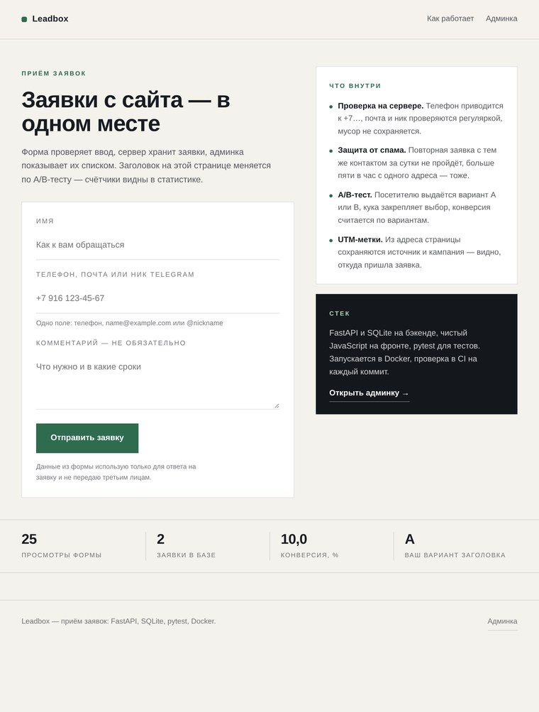
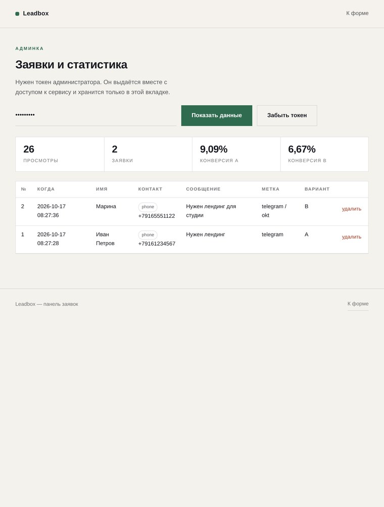

# Leadbox

Приём заявок с сайта: форма на странице, API, база и админка со статистикой. Плюс A/B-тест заголовка — чтобы было видно не только «форма работает», но и «заявки считаются по вариантам».



Заявки видны в админке — `/admin`, вход по токену администратора.



## Что умеет

- **Проверка на сервере.** Телефон приводится к виду `+79161234567`, почта и ник Telegram проверяются отдельно, мусор отклоняется с понятной ошибкой.
- **Одно поле для связи.** Телефон, почта или `@ник` — тип определяется сам, в базу пишется нормализованный вид.
- **Защита от повторов.** Заявка с тем же контактом второй раз за сутки не пройдёт; больше пяти заявок в час с одного адреса — блок.
- **A/B-тест.** Посетителю выдаётся вариант A или B, кука закрепляет выбор, конверсия считается по каждому варианту.
- **UTM-метки.** `utm_source` и `utm_campaign` из адреса сохраняются вместе с заявкой.
- **Админка.** Список заявок, счётчики по вариантам, удаление. Доступ по токену в заголовке `Authorization`.

## Стек

FastAPI, SQLite (стандартный `sqlite3`, без ORM), чистый JavaScript без сборки, pytest, Docker, GitHub Actions.

## Запуск

```bash
python3 -m venv .venv && source .venv/bin/activate    # Windows: .venv\Scripts\activate
pip install -r requirements-dev.txt

export ADMIN_TOKEN=dev-token
uvicorn app.main:app --reload
```

Открыть <http://127.0.0.1:8000>. Документация API — `/docs`.

Через Docker:

```bash
cp .env.example .env      # поменять ADMIN_TOKEN и IP_SALT
docker compose up --build
```

## Тесты

```bash
pytest                          # 48 проверок: валидаторы, API и гонка при записи
python3 checks/smoke.py         # проверка живого сервиса по HTTP
python3 checks/a11y.py          # доступность по WCAG через axe-core (нужен запущенный сервис)
```

`checks/a11y.py` открывает форму и админку в браузере и прогоняет axe-core по правилам WCAG 2.0/2.1/2.2 A и AA плюс best practice. Обе страницы дают 0 нарушений; проверка запускается в CI вторым заданием, чтобы нарушения не вернулись незамеченными.

Тесты API поднимают приложение в процессе и работают с временной базой — после прогона ничего не остаётся.

## Нагрузка

Замер на одной машине (тот же процесс, что и генератор нагрузки), поэтому цифры — про порядок величин, а не про прод. Генератор: Python + aiohttp, уникальные контакты, 10 секунд на точку.

| Потоков | Заявок в секунду | p50 | p95 |
|---|---|---|---|
| 1 | 644 | 1.5 ms | 1.9 ms |
| 10 | 415 | 4.7 ms | 109 ms |
| 25 | 378 | 7.6 ms | 335 ms |
| 50 | 373 | 31 ms | 661 ms |

Один процесс упирается в запись SQLite: чтение масштабируется, запись сериализуется. Четыре процесса (`--workers 4`) дают 1041 заявку в секунду на десяти потоках, но при 50 потоках всё равно 451 — общая блокировка базы остаётся.

**Что нашлось под нагрузкой.** Проверка дубля и вставка шли в разных транзакциях: 30 одновременных заявок с одним контактом проходили проверку вместе, и в базу ложилось до 22 записей вместо одной. В 20 волнах из 20 — ни одной чистой, в 11 волнах были дубли. Тот же разрыв касался и ограничения частоты.

Исправлено: проверки и вставка теперь в одной транзакции `BEGIN IMMEDIATE`, база переведена в режим WAL. После правки — 0 дублей в 20 волнах на одном процессе и на четырёх. Стоимость: при 25–50 одновременных записях p95 вырос (335–661 ms против 234–490 ms), потому что записи честно встают в очередь. Ценой меньшей задержки в пике была бы потеря защиты от дублей — обмен неудачный.

Проверка закреплена тестом `tests/test_concurrency.py`: 30 потоков с одним контактом — ровно одна запись, 30 потоков против лимита в 5 заявок — ровно пять принятых.

## API

| Метод | Путь | Доступ | Что делает |
|---|---|---|---|
| GET | `/api/health` | все | Проверка живости |
| GET | `/api/variant` | все | Выдаёт вариант A/B и ставит куку |
| POST | `/api/leads` | все | Создаёт заявку, 201 или 422 с ошибками по полям |
| GET | `/api/public-stats` | все | Только числа: просмотры, заявки, лучшая конверсия |
| GET | `/api/leads` | токен | Список заявок, `limit` и `offset` |
| DELETE | `/api/leads/{id}` | токен | Удаление заявки |
| GET | `/api/stats` | токен | Просмотры, заявки и конверсия по вариантам |

Пример:

```bash
curl -X POST http://127.0.0.1:8000/api/leads \
  -H 'Content-Type: application/json' \
  -d '{"name":"Иван","contact":"8 916 123-45-67","message":"Нужен лендинг","utm_source":"telegram"}'
```

```json
{"ok": true, "id": 1}
```

Ошибки приходят одинаково — код 422 и объект с полями:

```json
{"ok": false, "errors": {"contact": "Телефон не разобрать. Нужно 10–15 цифр, например +7 916 123-45-67."}}
```

## Как устроено

```
app/
  main.py        маршруты, авторизация админки, ограничение частоты
  validators.py  проверка и нормализация ввода — вся логика форматов здесь
  db.py          схема и запросы, SQLite
  static/        страница с формой, админка, стили, скрипт
tests/           48 проверок
checks/smoke.py  проверка живого сервиса по HTTP
```

Валидаторы вынесены отдельно, чтобы тестировать их без поднятия сервера: 34 проверки из 48 — на форматы телефона, почты и ника.

## Безопасность и данные

- Токен админки сравнивается через `hmac.compare_digest`, в репозиторий не попадает — только через переменные окружения.
- IP не хранится: в базу пишется хеш с солью, нужен только для ограничения частоты.
- Персональные данные не отдаются наружу: публичный эндпоинт возвращает три числа без имён и контактов.
- Админка закрыта от индексации (`noindex`), токен живёт в `sessionStorage` вкладки.

## Что дальше

- Отправка уведомления о новой заявке в Telegram — сейчас заявку видно только в админке.
- Экспорт в CSV и фильтры по дате.
- Переезд на PostgreSQL, когда заявок станет много: меняется только `db.py`.
